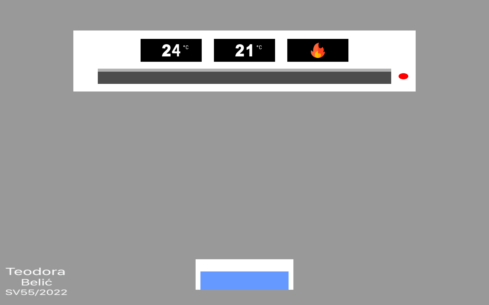

# Air Conditioner – 2D Graphics Simulation

An interactive 2D air conditioner simulation developed using **C++**, **OpenGL**, **GLFW**, and **GLEW**.

This application was developed as an individual project for the Computer Graphics course at the Faculty of Technical Sciences, University of Novi Sad.

The project demonstrates real-time 2D rendering, interactive controls, animation, and state management through a graphical simulation of an air conditioning system.

## Features

- **Interactive Controls** – Turn the air conditioner on or off by clicking its power indicator.
- **Temperature Adjustment** – Set the desired temperature between -10°C and 40°C using the arrow keys.
- **Temperature Simulation** – Automatically adjust the current temperature toward the selected value.
- **Operating Mode Indicators** – Display heating, cooling, or target-temperature status using graphical icons.
- **Animated Air Vent** – Smoothly open and close the air vent when the system changes state.
- **Water Collection Simulation** – Gradually fill a water container and automatically shut down the system when it reaches capacity.
- **Custom Cursor** – Use a remote-control-themed cursor.

## Technologies

| Component | Technology |
|---|---|
| Programming Language | C++ |
| Graphics API | OpenGL 3.3 |
| Windowing and Input | GLFW |
| OpenGL Extension Loading | GLEW |
| Image Loading | stb_image |
| Development Environment | Visual Studio |

## Controls

| Input | Action |
|---|---|
| Left mouse click on power indicator | Turn the air conditioner on/off |
| Up Arrow | Increase desired temperature |
| Down Arrow | Decrease desired temperature |
| Space | Empty the water container |
| Escape | Exit the application |

## Getting Started

### Prerequisites

- Visual Studio with C++ desktop development support
- OpenGL-compatible graphics hardware and drivers
- GLFW and GLEW dependencies

### Running the Application

1. Clone the repository.
2. Open `Kostur.sln` in Visual Studio.
3. Restore the required dependencies and configure the GLFW/GLEW library paths if necessary.
4. Build and run the project.

**Note:** The Visual Studio project contains machine-specific library paths, so additional configuration may be required.

## Preview

